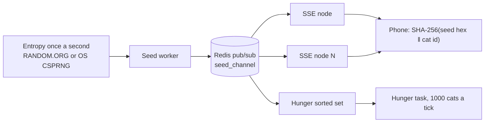

# e-pet backend

One shared seed, a million private cats. The server does not simulate each cat. Phones do. The server keeps the seed honest and the hunger clock honest, including cats whose owners are offline and cats that have already died.

This follows `rust_backend_sse_architecture.md`: a seed worker, Redis pub/sub, and stateless Rust SSE nodes. Hunger is the extra piece from the earlier design. Crate versions stay on Axum 0.8 and redis 0.27, which already compile here. The handbook's Axum 0.7 sample describes the same subscribe-and-fan-out behaviour.

## Pieces



| Piece | Job |
| --- | --- |
| Seed worker | Every second, draw 16 hex characters, store them, `PUBLISH` the JSON |
| Redis | Pub/sub bus. Every SSE node subscribes. The worker is the only publisher |
| SSE `/api/stream-seed` | Fan the payload out to whoever is connected to this node |
| Phone | `personal = SHA-256(utf8(seed_hex) ‖ utf8(cat_id))`. Behaviour rolls stay on the phone |
| Hunger sorted set | Score is the next unix second this living cat loses satiety |
| Hunger task | Runs with the worker. Every 500ms, take cats with `score <= now`, up to 1000 |

`ROLE=all` runs the worker, the hunger task, and one SSE server in a single process. The SSE task still subscribes to Redis, so the fan-out path is the same one a second node uses. `ROLE=sse` is a stateless extra node. `ROLE=worker` publishes and drains, and does not listen for HTTP.

A phone that connects between seconds receives the current payload first, then each new publish. A disconnected phone keeps its last seed until the stream returns.

## Seed payload

```json
{"seed":"0123456789abcdef","timestamp":1715002345,"type":"TRNG"}
```

`seed` is 16 lowercase hex characters (8 bytes). `type` is `TRNG` when RANDOM.ORG returned the string, and `LOCAL_CSPRNG_FALLBACK` when the operating system did.

RANDOM.ORG is the JSON-RPC method `generateStrings`: one string, length 16, alphabet `0123456789abcdef`, replacement on, 800ms timeout, at most once per second. The API key is `RANDOM_ORG_API_KEY`. The default `TRNG_SOURCE=os` never calls the network. A failed RANDOM.ORG call uses the OS for that second and labels it `LOCAL_CSPRNG_FALLBACK`.

The published seed replaces the previous one. Cats stay distinct because each phone salts the seed with its own id.

## Redis keys

Prefix defaults to `epet:`. An empty prefix is the handbook's bare names.

| Key | Type | Meaning |
| --- | --- | --- |
| `{prefix}global_current_seed` | string, 10s TTL | Latest seed JSON. A new SSE node reads this on subscribe |
| `{prefix}seed:{unix}` | string, 180s TTL | Hex seed for that second, so a loot claim can name the second |
| `{prefix}seed_channel` | pub/sub channel | Same JSON as the SSE `data` line |
| `{prefix}hunger` | sorted set | Member is the cat id. Score is the next drain time |
| `{prefix}cat:{id}` | hash | `name`, `fullness` (0–100), `status` `ALIVE` or `DEAD` |
| `{prefix}verdict:{id}:{timestamp}:{nonce}` | string, 180s TTL | `accepted`, `rejected`, or `expired` |

The 10-second key is the hot cache from the handbook. Loot claims quote an older timestamp, and a queue can sit longer than 10 seconds, so each second is also stored for 180 seconds.

Cat ids are 1–64 characters of ASCII letters, digits, `_`, and `-`.

## Hunger

A new cat starts at fullness 100 and is due 60 seconds later.

Each drain subtracts `1..=5`. The amount is

```text
personal = SHA-256(utf8(seed_hex) ‖ utf8(cat_id))
SHA-256(personal ‖ "drain" ‖ minute) 's first 8 bytes, as u64, mod 5, plus 1
```

`minute` is `unix_time / 60`. The same cat in the same minute always loses the same amount. The seed is whatever the worker published most recently.

Fullness at or below 0 sets `status=DEAD`, fullness 0, and `ZREM` from the hunger set. The next tick does not load that cat.

Feed adds fullness, capped at 100, and sets the next score to `now + 60`. Feed on a dead cat is rejected. Revive sets `ALIVE`, a fullness from 1 to 100, and puts the cat back on the wheel 60 seconds out.

Feed and drain are Lua scripts. Redis runs one script at a time, so a feed cannot be overwritten by a drain that read the old fullness.

The hunger task runs only in `ROLE=all` and `ROLE=worker`. SSE nodes do not drain.

## Behaviour weights

These run on the phone after a life event. The server does not replay them. `/verify` is only for a loot claim.

| Event | Weights |
| --- | --- |
| `FOOD_EVENT` (食) | sleep 50, groom 30, walk 15, zoomies 5 |
| `POOP_EVENT` (痾) | zoomies 60, walk 25, groom 10, sleep 5 |
| `WAKE_EVENT` (瞓醒) | hungry 60, walk 25, zoomies 10, groom 5 |

```text
personal = SHA-256(utf8(seed_hex) ‖ utf8(cat_id))
roll = first 8 bytes of SHA-256(personal ‖ event_name ‖ counter) as u64, mod 100
```

Walk the weights in the order above. `counter` is the client's own step for this seed, starting at 0.

## Loot check

A claimed pickup is the handbook's anti-cheat request:

```json
{
  "cat_id": "momo",
  "timestamp": 1715002345,
  "triggered_event": "LUCKY_ITEM_PICKUP",
  "action_nonce": 245
}
```

`POST /api/cats/{id}/verify` checks the path id, the optional `cat_id`, the event name, and that `action_nonce` is from 1 to 10000. It then returns `202 {"status":"received"}` and does the replay on a background task.

```text
personal = SHA-256(utf8(seed_hex) ‖ utf8(cat_id))
state = personal
repeat action_nonce times:
    state = SHA-256(state)
roll = first 8 bytes of state as a big-endian u64
hit = (roll mod 100) < 5
```

The handbook does not fix the loot odds. This server treats a hit as 5 of 100 so the check has a real window. `accepted` means the roll landed in that window. `rejected` means it did not. `expired` means the seed for that unix second is already gone. The string is logged and written to the verdict key.

There is no reward inventory and no ban list yet. The verdict is the whole result.

## HTTP

| Method | Path | Body | Result |
| --- | --- | --- | --- |
| `GET` | `/health` | | 200 when Redis answers |
| `GET` | `/api/stream-seed` | | SSE. `data` is the seed JSON, or `{"error":"client_lag"}` |
| `POST` | `/api/cats` | `{ "id", "name?" }` | 201 cat, fullness 100 |
| `GET` | `/api/cats/{id}` | | Cat hash |
| `POST` | `/api/cats/{id}/feed` | `{ "amount?" }` | New fullness. Default amount 30. 409 if dead |
| `POST` | `/api/cats/{id}/revive` | `{ "fullness?" }` | 204. Default fullness 40 |
| `POST` | `/api/cats/{id}/verify` | `{ "timestamp", "triggered_event", "action_nonce", "cat_id?" }` | 202 `{"status":"received"}` |

The SSE keep-alive is a comment, `: ping`, every 15 seconds. The local broadcast buffer holds 16 payloads. A slower client gets one lag event and then the next seeds.

## Production notes

These are for a Linux host in front of real traffic. They are not applied on a development Mac.

File descriptors, in `/etc/security/limits.conf`:

```text
* soft nofile 1048576
* hard nofile 1048576
root soft nofile 1048576
root hard nofile 1048576
```

Sysctl:

```text
fs.file-max = 2097152
net.core.somaxconn = 65535
net.ipv4.tcp_rmem = 1024 4096 16384
net.ipv4.tcp_wmem = 1024 4096 16384
net.ipv4.tcp_tw_reuse = 1
net.ipv4.tcp_fin_timeout = 15
net.ipv4.tcp_max_orphans = 262144
```

Then `sysctl -p`.

Put Cloudflare in front of `GET /api/stream-seed`. Cloudflare can hold the public SSE connections. The origin then keeps a small number of streams to the edge. Add capacity by running more `ROLE=sse` processes behind a load balancer. They share Redis and hold no cat state. The seed worker stays a single process so RANDOM.ORG is called once per second, not once per node.

The handbook's memory sketch: about 1 KB per SSE connection in Rust, on the order of 1–2 GB for a million connections on one 2-core 4 GB box, against roughly 15–30 KB and 20–30 GB for a Node connection. SSE is the wire protocol. WebSocket is not used.

## What this does not do

It does not render the cat, store accounts, grant items, or run the blink loop. A million blinks a second belong on the phones. The server's job is the seed, the hunger clock, and a replay when a client claims a pickup.
