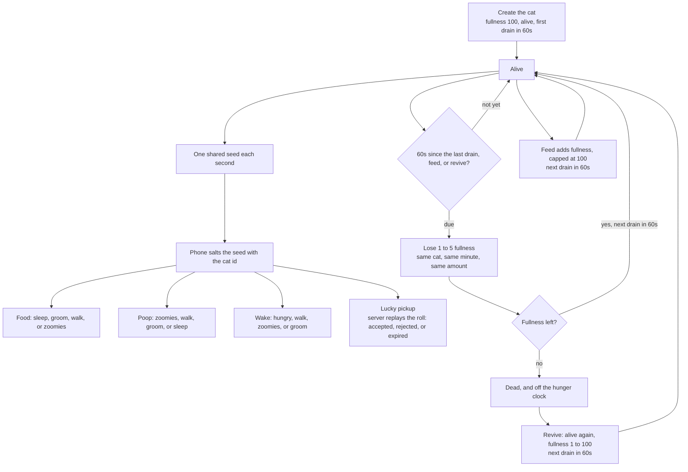

# e-pet-backend

Rust backend for a million electronic cats. One seed worker publishes a random seed each second on Redis. Stateless SSE nodes subscribe and fan that payload out. Each phone salts the seed with its cat id and rolls behaviour locally. Satiety stays on the server: a Redis sorted set wakes only the living cats that are due.

## How a cat lives

The phone plays the cat. The server keeps one shared seed and the hunger clock, including cats whose owners are offline.



A feed on a dead cat is refused. The pickup check does not change fullness.

## Run

Redis on `127.0.0.1:6379`. `docker compose up -d` starts one if you need it.

```sh
cargo run
```

`ROLE=all` (the default) runs the seed worker and the SSE server in one process. `ROLE=worker` only publishes seeds and drains hunger. `ROLE=sse` only subscribes and serves HTTP, which is how you add another node.

`TRNG_SOURCE=os` (the default) reads 8 bytes from the operating system and sends them as 16 hex characters with `"type":"LOCAL_CSPRNG_FALLBACK"`. `TRNG_SOURCE=random_org` calls RANDOM.ORG JSON-RPC `generateStrings` once per second. Set `RANDOM_ORG_API_KEY` in the environment. If the key is missing or the call fails, that second uses the OS source.

| Variable | Default |
| --- | --- |
| `REDIS_URL` | `redis://127.0.0.1/` |
| `BIND` | `0.0.0.0:3000` |
| `KEY_PREFIX` | `epet:` |
| `TRNG_SOURCE` | `os` |
| `RANDOM_ORG_API_KEY` | unset |
| `ROLE` | `all` |

An empty `KEY_PREFIX` uses the handbook names `seed_channel` and `global_current_seed`. The default prefix keeps those keys under `epet:`.

```sh
curl -s -X POST localhost:3000/api/cats -H 'content-type: application/json' -d '{"id":"momo","name":"Momo"}'
curl -N localhost:3000/api/stream-seed
curl -s -X POST localhost:3000/api/cats/momo/feed -H 'content-type: application/json' -d '{"amount":20}'
curl -s -X POST localhost:3000/api/cats/momo/verify -H 'content-type: application/json' \
  -d '{"timestamp":1715002345,"triggered_event":"LUCKY_ITEM_PICKUP","action_nonce":245}'
```

`GET /api/stream-seed` is an SSE stream. Each `data` line is `{"seed":"<16 hex chars>","timestamp":<unix seconds>,"type":"TRNG"}` or `"type":"LOCAL_CSPRNG_FALLBACK"`. A new connection also receives the current seed. A client that falls behind gets `{"error":"client_lag"}`. A comment line `: ping` arrives every 15 seconds.

`/verify` returns `202 {"status":"received"}` and checks the claim off the request. The verdict is logged and stored at `{prefix}verdict:{cat}:{timestamp}:{nonce}` for 180 seconds: `accepted`, `rejected`, or `expired`.

The client contract, the hunger wheel, and the production notes are in [DESIGN.md](DESIGN.md).

```sh
cargo test
```
